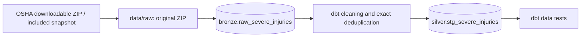

# Workplace Injury Data Platform

A Docker-based Data Engineering project using public OSHA Severe Injury Report
data. The current implementation covers source acquisition, raw ingestion into
DuckDB and silver cleaning with dbt.

My experience working with safety data in Global SHE motivated the choice of
dataset. This phase establishes a reliable report-level dataset before selecting
a downstream analytical or predictive use case.

## Current architecture



The current source is a downloadable ZIP containing a CSV. An API integration
has not been implemented.

| Layer | Responsibility |
|---|---|
| Source | OSHA CSV snapshot distributed as a ZIP |
| Raw / bronze | Retain the ZIP and ingest every CSV record into DuckDB as text |
| Silver | Rename columns, trim whitespace, convert empty values to null, parse types and remove exact source duplicates |

Gold and ML are deferred until the business use case and required outputs are
defined. The former experiments, reports and gold models have been removed from
the active repository.

## Quick start with Docker

Install Docker Engine or Docker Desktop with Docker Compose. On Windows, enable
the WSL 2 engine and Ubuntu integration in Docker Desktop, then run the commands
below from Ubuntu/WSL in the repository root.

```bash
docker version
docker compose build
docker compose run --rm pipeline
```

`docker version` must show both Client and Server. A missing
`/var/run/docker.sock` indicates that the terminal cannot reach the Docker engine.

Compose mounts the included `January2015toOctober2025.zip` read-only as
`/opt/source/osha.zip`. On first execution, the pipeline copies it to the data
volume automatically. This supports reproducible execution when OSHA rejects
automated downloads with HTTP 403.

The pipeline stops on a failed stage and runs acquisition, bronze loading, and
`dbt build`. It exits after silver validation.

### Inspect the database

```bash
docker compose run --rm pipeline python src/inspect_raw_data.py
```

This prints bronze/silver row counts, column types and the silver date range.

### Explore data in the browser

After the pipeline has completed, start the optional DuckDB UI service.

```bash
docker compose up -d --build duckdb-ui
```

Open [http://localhost:4213](http://localhost:4213) using the hostname
`localhost`. The native UI checks the browser origin, so use this URL
consistently.

The database is attached as `injuries`. Expand its `bronze` and `silver`
schemas in the explorer, then open a SQL notebook and run queries such as:

```sql
SELECT *
FROM injuries.silver.stg_severe_injuries
LIMIT 100;

SELECT state, count(*) AS reports
FROM injuries.silver.stg_severe_injuries
GROUP BY state
ORDER BY reports DESC;
```

The viewer mounts `pipeline-data` read-only and attaches the database in read-only
mode. UI notebooks and metadata use a separate writable `ui-data` volume.
The browser port is published on the local computer's loopback address.

Stop the viewer before loading or rebuilding data so DuckDB can obtain its
write lock. Restart it after the pipeline finishes.

```bash
docker compose stop duckdb-ui
docker compose run --rm pipeline
docker compose up -d duckdb-ui
```

Use the same Compose project name for the pipeline and viewer. If you loaded
data with `-p incident-medallion`, start its viewer with:

```bash
docker compose -p incident-medallion up -d --build duckdb-ui
```

If the database is missing, the viewer exits with an instruction to run the
pipeline first. Check service status and logs when troubleshooting:

```bash
docker compose ps duckdb-ui
docker compose logs --tail 50 duckdb-ui
```

The `tools` profile keeps the viewer optional when running the batch pipeline.
Its separate image installs the official DuckDB UI extension and a TCP forwarder
for access through Docker Desktop's normal port mapping. The forwarder supports
DuckDB's IPv4 or IPv6 loopback listener. Host networking configuration is not
required.

The native UI fetches its frontend assets from `https://ui.duckdb.org` and needs
internet access to load them. Queries against the attached local database execute
locally. See [DuckDB UI documentation](https://duckdb.org/docs/stable/core_extensions/ui).

### Persistence and repeat runs

The Compose-managed `pipeline-data` volume holds the source ZIP and
`data/processed/safety.duckdb`. Each computer has its own volume.

- Acquisition reuses a valid ZIP already present in the volume.
- Bronze is replaced with the complete current CSV on each run.
- Silver is rebuilt as a table on each run.
- Execute one pipeline at a time against the database.
- `docker compose down` preserves the volume. Adding `--volumes` deletes it.

This is a full-refresh snapshot pipeline. Historical versions and incremental
ingestion are future design decisions. Rebuilding silver requires rerunning dbt.

Existing volumes can still contain tables from the previous project scope.
They are outside the current pipeline. To start with a separate database while
preserving the old volume, use a different Compose project name consistently.

```bash
docker compose -p incident-medallion run --rm pipeline
```

## Source acquisition and configuration

The downloader first reuses `data/raw/osha_severe_injuries.zip`, then checks the
configured local source ZIP. If neither exists, it requests the OSHA download URL.
Files are validated as ZIPs before being published at the destination.

| Variable | Container default / Compose value |
|---|---|
| `PROJECT_ROOT` | `/opt/project` |
| `DUCKDB_PATH` | `/opt/project/data/processed/safety.duckdb` |
| `DBT_PROFILES_DIR` | `/opt/project/config/dbt` |
| `SOURCE_ZIP_PATH` | `/opt/source/osha.zip` in Compose |

To use another local snapshot, change the source bind mount in `compose.yaml`.
Acquisition reuses the existing destination ZIP, so use a separate Compose project
volume for a new snapshot, or explicitly replace the destination before rerunning.

The original source URL is
[OSHA Severe Injury Reports ZIP](https://www.osha.gov/sites/default/files/January2015toOctober2025.zip).
The included snapshot covers January 2015 through October 2025.

## Data contracts

### Bronze

`bronze.raw_severe_injuries` preserves source column names and parsed CSV field
values, including empty strings, leading zeros, whitespace and duplicate rows.
All columns are stored as text. The ZIP retains the original file bytes.

Reading CSV necessarily decodes its format. Bronze preserves field values rather
than the CSV quoting or line-ending representation. The loader requires exactly
one CSV in the ZIP.

### Silver

`silver.stg_severe_injuries` is materialized as a table.

- Column names use snake_case.
- Text fields are trimmed and empty values become null.
- State abbreviations are uppercased.
- Dates use the source month/day/year format.
- Coordinates and source outcome counts are converted to numeric types.
- Identifiers, postal codes, industry codes and injury classification codes
  remain text.
- Exact duplicates across all raw columns are removed before cleaning.
- No target, feature set, aggregation or outcome imputation is introduced.

One row represents a reported case after exact-source deduplication.
`incident_id` alone is not globally unique. The observed combination
`incident_id + event_date` is tested, rather than assumed to be a permanent source
guarantee. Conflicting records fail validation and are retained for investigation.

Missing counts remain null. Non-empty date or numeric values that cannot be
parsed fail a data test. Failed runs may leave rebuilt tables in place, so a
successful process exit is required before consuming silver.

## Quality checks

dbt validates:

- Non-null incident identifiers and parsed event dates.
- Uniqueness of the observed incident/date key.
- Silver row count equals the number of distinct raw records.
- Non-empty source date and numeric values can be parsed.

Run the same build and tests independently inside the container.

```bash
docker compose run --rm pipeline dbt build --project-dir osha_injury_ml
```

Bronze must already exist. Unit/integration checks can be run locally with
`python -m unittest discover -s tests -v` after installing `requirements.txt`.

## Verification

The Docker image was built and the complete pipeline passed against a new,
independent validation volume using Python 3.12.

- Bronze and silver each contain 105,318 rows for the included snapshot.
- All bronze columns are VARCHAR and the retained ZIP matches the source SHA-256.
- All five dbt data tests pass.
- The new database contains no gold tables.
- The browser service returns HTTP 200 and a SQL query over HTTP returns
  105,318 silver rows. Attempted writes to the attached data are rejected.
- Three regression tests pass, covering exact duplicates, repeated IDs on distinct
  dates, leading zeros, whitespace, empty source counts, repeat runs, conflicting
  keys and malformed numeric input.

The validation used the included snapshot. It does not establish that OSHA
currently accepts automated downloads.

## Development

```bash
docker compose -f compose.yaml -f compose.dev.yaml run --rm pipeline
```

This mounts the source code and dbt project. Rebuild the image after changing
runtime dependencies.

For local Python execution, install `requirements.txt` in a virtual environment
and run `python src/run_pipeline.py`. Paths resolve from the repository, and
the runner supplies dbt environment variables.

The DAG in `dags/osha_pipeline.py` provides the same acquisition, loading and
silver-build sequence for an existing Airflow 3 installation with the standard
provider. Airflow services are outside the current Compose configuration.

## Repository structure

```text
.
├── Dockerfile
├── compose.yaml
├── compose.dev.yaml
├── config/dbt/profiles.yml
├── January2015toOctober2025.zip
├── src/
│   ├── browse_data.py
│   ├── config.py
│   ├── download_data.py
│   ├── load_to_duckdb.py
│   ├── run_pipeline.py
│   └── inspect_raw_data.py
├── osha_injury_ml/
│   ├── models/staging/
│   ├── tests/
│   ├── macros/
│   └── dbt_project.yml
├── dags/osha_pipeline.py
├── tests/
└── docs/learning_notes.md
```

The dbt directory/profile keeps its existing `osha_injury_ml` name for
configuration compatibility. Its active scope is bronze sources and silver.

## Next decisions

- Select an analytical consumer and define gold outputs from its requirements.
- Decide whether source revisions require immutable snapshot history.
- Define refresh frequency and operational monitoring.
- Evaluate an API source if it adds value beyond the current downloadable snapshot.

Implementation decisions are recorded in
[learning notes](docs/learning_notes.md).
